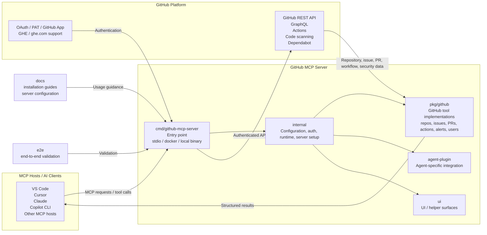

# GitHub MCP Server Architecture Overview

This repository implements a GitHub-aware Model Context Protocol (MCP) server that exposes GitHub capabilities to MCP clients such as VS Code, Copilot CLI, Claude, Cursor, and other AI hosts.

## Architecture Notes

- The server is designed to be consumed by MCP-compatible clients over stdio or via a hosted remote GitHub MCP endpoint.
- `cmd/github-mcp-server` is the runtime entry point for local binaries and Docker-based deployments.
- `internal` contains the core server lifecycle, configuration, and authentication wiring.
- `pkg/github` exposes the actual GitHub tool implementations and adapters for repos, issues, pull requests, workflow actions, code security, and user context.
- `agent-plugin` and `ui` add integration points for agent experiences and supporting surfaces.
- External dependencies are GitHub APIs and authentication mechanisms such as OAuth tokens, PATs, and GitHub Enterprise deployments.
- `docs` and `e2e` provide installation, configuration, and validation support for operators and maintainers.

## Primary Flow

1. An MCP client issues a request to the GitHub MCP server.
2. The server authenticates using OAuth, a PAT, or GitHub App credentials.
3. Tool implementations in `pkg/github` call the appropriate GitHub APIs.
4. Structured results are returned to the MCP client as tool responses.
5. The client can then reason over repos, code, issues, pull requests, actions, and security signals.
